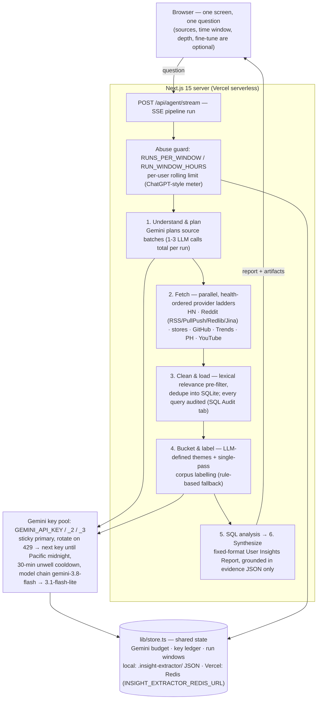

# Insight Extractor

Type one question. Insight Extractor reads what real people say about it across **eight public sources** (Hacker News, Reddit, App Store, Play Store, GitHub, Google Trends, Product Hunt, YouTube), groups it into insight themes, and returns a clear report with real quotes as proof. Built for product decisions: problem discovery, validation, post-launch feedback, competitor comparison, feature prioritization.

**Live:** [https://insightextractor-kappa.vercel.app](https://insightextractor-kappa.vercel.app) — deployed on Vercel (serverless + Redis).

## System design



**Key decisions**

- **≤3 Gemini calls per run** (rapid = 1, raw-data = 2, standard = 3). Every stage degrades to an honest non-LLM fallback when quota is gone — a run never fails hard and never fabricates (0 records + an explicit gap note). The Reddit channel runs on the master-plan brief with **zero extra LLM calls** and files a deterministic accountability audit.
- **Key rotation** is sticky and ledger-based: the primary key serves until it errors; a 429 records it exhausted (e.g. 20/20) until Pacific midnight; transient failures get a 30-min cooldown. No status-probe queries — the per-key, per-UTC-day ledger *is* the usage count (no usage API on the free tier).
- **Shared state in one module** (`lib/store.ts`): local JSON on disk for single-instance; Redis (e.g. free Upstash) on Vercel so the Gemini budget and run windows are enforced platform-wide across instances/regions. Store down → fails open to in-memory + files.
- **Degrades, not dies**: a failing API is skipped fast (per-provider timeouts), recorded in a persistent health ledger, and the next provider takes its shard (2+ failures sink a provider, successes promote it).
- **Stateless-safe on Vercel**: no local-FS assumptions in production; keys set via Settings persist per-instance, so set them as Vercel env vars for durability. Deep dives take 3–6 min (on Hobby, quick scan is the safer default).

## Run it

```bash
npm install
npm run dev          # http://localhost:3001
npm test             # vitest suite
npm run typecheck    # tsc --noEmit
npm run lint         # banned-pattern checks
npm run build && npm start
```

Keys live in `.env.local` (or paste them in Settings — they persist server-side and are never returned to the client):

```env
GEMINI_API_KEY=...            # required for full mode
GEMINI_API_KEY_2=             # optional — rotates in automatically
GEMINI_API_KEY_3=             # optional
GEMINI_MODEL=gemini-3.8-flash # fallback chain: 3.6 → 3.5 → 3.1-flash-lite
GEMINI_DAILY_QUOTA=20         # free-tier requests/day per key
RUNS_PER_WINDOW=5             # per-user agent runs per rolling window
RUN_WINDOW_HOURS=5
# PRODUCTHUNT_API_TOKEN=      # optional
# YOUTUBE_API_KEY=            # optional
# INSIGHT_EXTRACTOR_REDIS_URL # multi-instance (Vercel)
```

## The app

One screen, one question — two interactions start a research (type, press Start). Routes: `/` (home) · `/research/:id` (running → results, four states) · `/library` (date groups, search, rename, remove-with-undo) · `/settings` (AI key, usage, connections, appearance, source health) · `/sample` (built-in sample run) · `/dev/ui` (component gallery, 404 in production). "Edit and run again" prefills any saved research.

## API

| Route | Purpose |
|---|---|
| `POST /api/agent/stream` | SSE pipeline run (full request validation) |
| `GET /api/sources/health` | sources, provider ladders, Gemini usage, run window |
| `GET /api/runs` / `GET /api/runs/:id` | caller's run history / one stored run (owner only) |
| `POST /api/settings` | store any `UPPER_SNAKE_CASE` key server-side |

## Layout

```
app/         Next.js routes (home, research, library, settings, sample) + API
components/  UI components
lib/         server pipeline: gemini.ts (keys/ledger), store.ts (shared state),
             pipeline.ts, report.ts, sql.ts, health.ts, sources/, runs.ts
tests/       vitest suites · scripts/ · styles/
```

**Specs:** [UI audit spec](UI_AUDIT_SPEC.md) · `docs/` for pipeline and report-format details.
